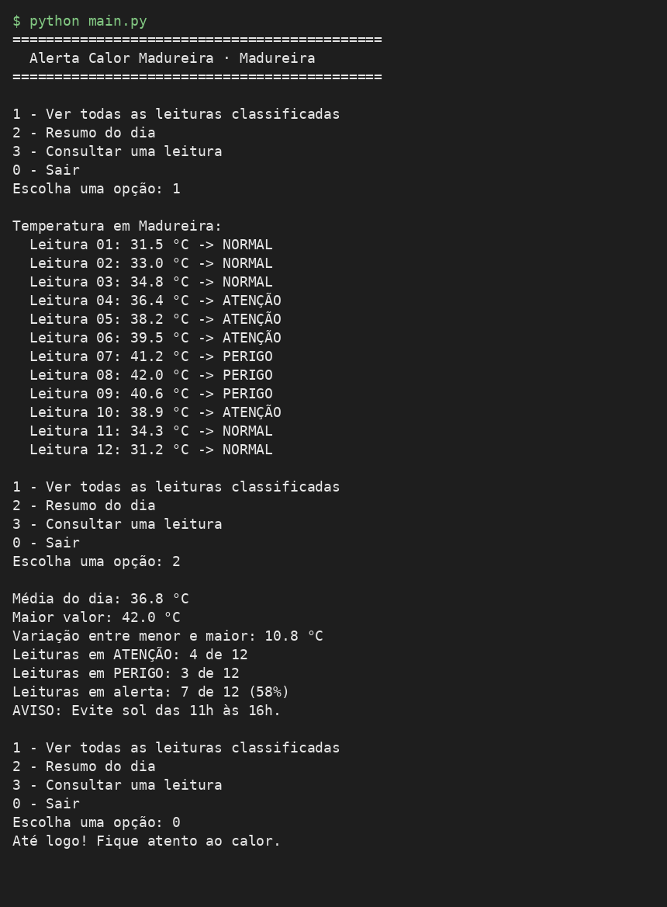

# Lógica · O Cérebro da CitizenTech

Parte de **Computational Thinking with Python** da CitizenTech **Alerta Calor Madureira**.

## O que o programa faz

O programa recebe uma lista de 12 leituras de temperatura de Madureira e classifica cada uma em NORMAL, ATENÇÃO ou PERIGO usando `if/elif/else`. Por meio de um menu, o cidadão vê todas as leituras classificadas, um resumo do dia e a consulta de uma leitura específica, sempre com um aviso em linguagem simples (por exemplo, "Evite sol das 11h às 16h.").

## Como rodar

1. Instale o Python 3 (o mesmo usado nas aulas).
2. Abra esta pasta no terminal ou no PyCharm.
3. Rode:

```bash
python main.py
```

## De onde vêm os dados

- **Grandeza medida:** temperatura em °C
- **Quantidade de registros:** 12
- **Origem:** simulados pela equipe (sem dados pessoais)

## Faixas de decisão

Os mesmos limites usados no circuito de Edge e os mesmos textos da página.

| Faixa | Condição | Aviso para o cidadão |
|---|---|---|
| NORMAL | valor < 35 | Tudo certo por enquanto. |
| ATENÇÃO | 35 ≤ valor < 40 | Beba água e procure sombra. |
| PERIGO | valor ≥ 40 | Evite sol das 11h às 16h. |

## Resumo calculado

A opção 2 mostra:

- **Média** das leituras do dia
- **Maior valor** registrado
- **Variação** entre o menor e o maior valor (conta extra da equipe)
- **Quantidade de leituras em ATENÇÃO e em PERIGO**
- **% de leituras em alerta** (ATENÇÃO + PERIGO)
- **Aviso final** para o cidadão: PERIGO se houver alguma leitura perigosa; ATENÇÃO se a média ou alguma leitura estiver na faixa de atenção; NORMAL nos demais casos

## Integração com as outras partes

| Parte | Como conversa com o Python |
|---|---|
| Sensor · Edge | Os registros simulam as leituras do circuito; as faixas são as mesmas (35 °C e 40 °C). |
| Experiência · STXD | As opções do menu saíram da jornada do cidadão: ver o que está acontecendo, entender o dia e consultar um momento específico. |
| Interface · Front-end | As mensagens impressas são os textos da página. |
| Interação · Web Dev | A regra de decisão foi reescrita em JavaScript com os mesmos limites. |
| Pitch · Storytelling | O programa rodando aparece no vídeo. |

## Execução

Saída real do programa (menu, opção 1 e resumo):

```text
============================================
  Alerta Calor Madureira · Madureira
============================================

1 - Ver todas as leituras classificadas
2 - Resumo do dia
3 - Consultar uma leitura
0 - Sair
Escolha uma opção: 1

Temperatura em Madureira:
  Leitura 01: 31.5 °C -> NORMAL
  Leitura 02: 33.0 °C -> NORMAL
  Leitura 03: 34.8 °C -> NORMAL
  Leitura 04: 36.4 °C -> ATENÇÃO
  Leitura 05: 38.2 °C -> ATENÇÃO
  Leitura 06: 39.5 °C -> ATENÇÃO
  Leitura 07: 41.2 °C -> PERIGO
  Leitura 08: 42.0 °C -> PERIGO
  Leitura 09: 40.6 °C -> PERIGO
  Leitura 10: 38.9 °C -> ATENÇÃO
  Leitura 11: 34.3 °C -> NORMAL
  Leitura 12: 31.2 °C -> NORMAL

Escolha uma opção: 2

Média do dia: 36.8 °C
Maior valor: 42.0 °C
Variação entre menor e maior: 10.8 °C
Leituras em ATENÇÃO: 4 de 12
Leituras em PERIGO: 3 de 12
Leituras em alerta: 7 de 12 (58%)
AVISO: Evite sol das 11h às 16h.
```



## Antes de enviar

- [x] O programa roda do início ao fim, e o menu só termina no **0 - Sair**
- [x] A lista tem 10 ou mais registros do problema da equipe
- [x] Cada registro é classificado com `if/elif/else`, com faixas que fazem sentido
- [x] O resumo mostra média, maior valor e % de leituras em alerta
- [x] Letra, número fora do menu e Enter vazio não derrubam o programa
- [X] Faixas e avisos iguais aos do circuito e da página (confirmar com Edge, Front-end e Web Dev)
- [X] Este README está preenchido, com print, e o `prompts.md` está atualizado
- [X] Todos os integrantes sabem explicar qualquer linha do `main.py`
